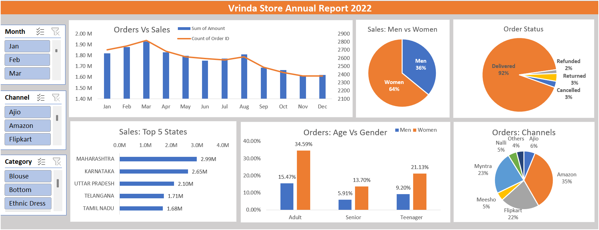
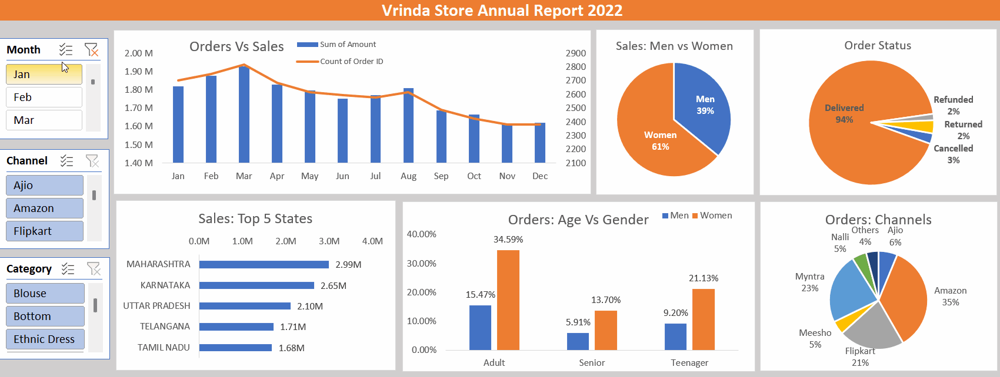

# 📊 Vrinda Store Sales Analysis | Excel Dashboard

An interactive Excel dashboard analysing the 2022 sales performance of **Vrinda Store**, a fashion e-commerce brand.
It covers sales trends, customer demographics, order status, channel and state performance, using
**Pivot Tables, Pivot Charts and Slicers**.

### Interactive demo

Month, Channel and Category slicers filter every chart on the dashboard at once.

## 🛠 Tools Used
- Microsoft Excel
- Pivot Tables and Pivot Charts
- Slicers
- Dashboard design

## 📁 Dataset
Source: <add the name or link of where you downloaded the dataset>
- 31,047 order lines (28,471 unique Order IDs), Jan-Dec 2022
- Columns include Order ID, Date, Gender, Age Group, Status, Channel, Category, Size, Qty, Amount, ship-city, ship-state
- Total sales: about 21.2M INR
- Charts count rows by Order ID, so "orders" below means order lines

## 📊 Dashboard Features
- Orders vs Sales trend by month (sales amount and order count)
- Sales split: Men vs Women
- Order status: Delivered, Returned, Cancelled, Refunded
- Top 5 states by sales
- Orders by age group and gender
- Orders by sales channel
- Month, Channel and Category slicers

## 📊 Key Business Insights

### 1. Women Customers Drive the Majority of Sales
Women contribute **64% of total sales** (13.56M), while men account for **36%** (7.61M).
This indicates that the primary customer segment is women.

### 2. Amazon is the Top Sales Channel
Amazon generates **35% of total orders**, making it the most important sales channel, followed by **Myntra (23%)** and **Flipkart (22%)**.

### 3. Maharashtra Generates the Highest Revenue
**Maharashtra contributes the highest sales (2.99M)**, followed by Karnataka (2.65M) and Uttar Pradesh (2.10M).

### 4. Adult Women are the Dominant Buyers
The **adult age group (especially women)** accounts for the highest share of orders (34.59% of orders), indicating strong demand from this demographic.

### 5. High Order Fulfillment Rate
Approximately **92% of orders are successfully delivered**, while only a small percentage are cancelled (3%), returned (3%) or refunded (2%).

### 6. Seasonal Sales Trend
Sales peak during the **early months of the year**, particularly around **March (1.93M)**, and gradually decline toward the later months (about 1.62M in November and December).

## 📈 Business Recommendations
- Focus marketing efforts on **women customers**, especially in the adult segment.
- Strengthen product listings and advertisements on **Amazon**, the leading sales channel.
- Increase marketing and inventory in **high-performing states like Maharashtra and Karnataka**.
- Improve product descriptions and size guides to **reduce returns**.
- Plan promotions and discounts during **low-sales months** to maintain steady revenue.

## 📂 Project Files
- `Vrinda_Store_Data_Analysis.xlsx`: raw data, pivot sheets, dashboard and business insights sheet
- `dashboard.png`: dashboard screenshot
- `demo.gif`: interactive slicer demo

## 🎯 Conclusion
This project shows how an Excel dashboard can turn raw sales data into clear business insights and practical
recommendations that support data-driven decision-making.

## 👩‍💻 Author
Nidhi Gupta | [LinkedIn](https://www.linkedin.com/in/nidhigupta1997) | [GitHub](https://github.com/nidhigupta868714-ai)
